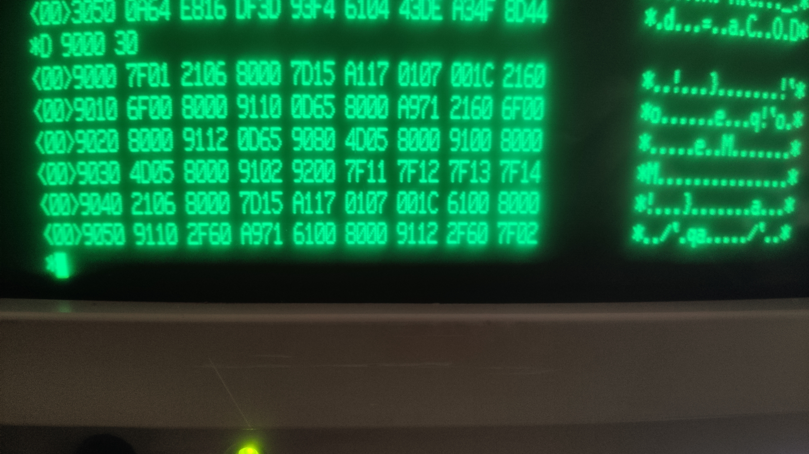
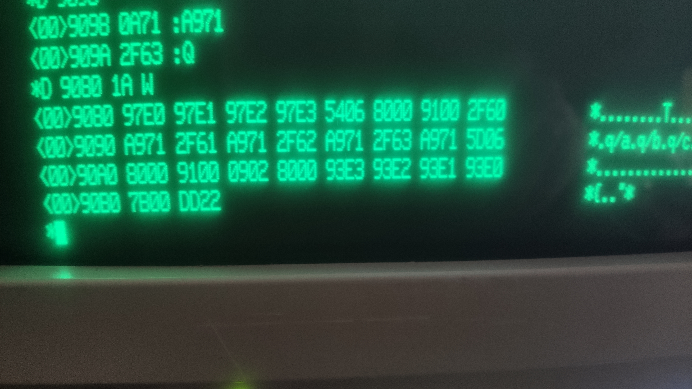
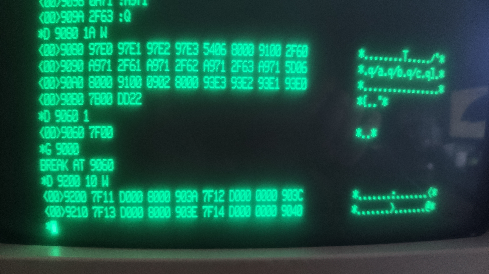

# Test 01: bit 15 of the saved PC segment word (trap frame and IRET)

Status: **done on the real machine** (2026-10-16), result equals the emulator.

## What is tested

When the Z8001 takes a system call (or any trap), it pushes a frame: identifier word, FCW,
PC segment word, PC offset. The PC segment word has the "SEG" flag in bit 15 in front of
the 7 bit segment number. The U8000 CPU description (6.6.2, figures 6.1 and 6.2) does not
say whether this bit is pushed as the PC holds it and what IRET does with it when it is
changed in the frame.

The test is a small MON16 program that calls `sc` four times. The handler in the program
status area copies the frame to memory, **flips bit 15** of the saved PC segment word and
returns with `IRET`. If IRET loads the bit back unchanged and the next trap pushes the PC
as it is, the saved bit alternates from call to call.

## Procedure

Start: reset, Return at the 8 bit monitor, `X`, any key at "Press NMI", then NMI (nothing
else before the NMI, any input stops the boot). At the `*` prompt of MON16: `D <address>`,
then every word on its own line, then `Q`. `G <address>` starts the program, the monitor
answers `BREAK AT ...`. `D <address> <count> W` shows memory (count in words). Hex digits in
upper case only.

Program main (49 words at `%9000`, runs segmented after `sc #1`, writes the frames to
`%9200`):

```
7F01 2106 8000 7D15 A117 0107 001C 2160
6F00 8000 9110 0D65 8000 A971 2160 6F00
8000 9112 0D65 9080 4D05 8000 9100 8000
4D05 8000 9102 9200 7F11 7F12 7F13 7F14
2106 8000 7D15 A117 0107 001C 6100 8000
9110 2F60 A971 6100 8000 9112 2F60 7F02
7F00
```

Handler (25 words at `%9080`):

```
97E0 97E1 97E2 97E3 5406 8000 9100 2F60
A971 2F61 A971 2F62 A971 2F63 A971 5D06
8000 9100 0902 8000 93E3 93E2 93E1 93E0
7B00
```

Enter both with `D 9000` / `D 9080`, `G 9000`, then `D 9200 10 W` (the generator is
`tools/gen.py`). Lower case hex is rejected by the real MON16.

## Assembler listing

Address, machine words, instruction, comment (hand assembled; the words are what you type).

```
; main program, runs in segmented mode (sc #1); rr6 points into the program status area
9000  7F01                 sc   #1                   ; MON16: switch to segmented mode
9002  2106 8000            ld   r6,#%8000            ; segment word of rr6: segment 0 in long form
9006  7D15                 ldctl r1,PSAPOFF          ; offset of the program status area (PSAP)
9008  A117                 ld   r7,r1                
900A  0107 001C            add  r7,#%1C              ; rr6 -> PC segment word of the system call entry (PSAP+1C)
900E  2160                 ld   r0,@rr6              ; old PC segment word of the sc vector
9010  6F00 8000 9110       ld   %9110,r0             ; keep it
9016  0D65 8000            ld   @rr6,#%8000          ; new vector: PC segment word %8000 (bit 15 set)
901A  A971                 inc  r7,#2                ; -> PC offset word of the vector
901C  2160                 ld   r0,@rr6              ; old PC offset
901E  6F00 8000 9112       ld   %9112,r0             ; keep it
9024  0D65 9080            ld   @rr6,#%9080          ; new vector: PC offset = handler at %9080
9028  4D05 8000 9100 8000  ld   %9100,#%8000         ; frame buffer pointer, segment word
9030  4D05 8000 9102 9200  ld   %9102,#%9200         ; frame buffer pointer, offset: frames go to %9200
9038  7F11                 sc   #%11                 ; system call 1: the handler stores the frame, flips bit 15, IRET
903A  7F12                 sc   #%12                 ; system call 2: the handler stores the frame, flips bit 15, IRET
903C  7F13                 sc   #%13                 ; system call 3: the handler stores the frame, flips bit 15, IRET
903E  7F14                 sc   #%14                 ; system call 4: the handler stores the frame, flips bit 15, IRET
9040  2106 8000            ld   r6,#%8000            ; restore the vector
9044  7D15                 ldctl r1,PSAPOFF          
9046  A117                 ld   r7,r1                
9048  0107 001C            add  r7,#%1C              
904C  6100 8000 9110       ld   r0,%9110             
9052  2F60                 ld   @rr6,r0              ; old PC segment word back
9054  A971                 inc  r7,#2                
9056  6100 8000 9112       ld   r0,%9112             
905C  2F60                 ld   @rr6,r0              ; old PC offset back
905E  7F02                 sc   #2                   ; MON16: back to non segmented mode
9060  7F00                 sc   #0                   ; BREAK: back to the monitor

; handler for the system call vector, runs on the system stack (rr14)
9080  97E0                 pop  r0,@rr14             ; identifier word (7F11 ... 7F14)
9082  97E1                 pop  r1,@rr14             ; saved FCW
9084  97E2                 pop  r2,@rr14             ; saved PC segment word (bit 15 is what we look at)
9086  97E3                 pop  r3,@rr14             ; saved PC offset
9088  5406 8000 9100       ldl  rr6,%9100            ; rr6 := frame buffer pointer
908E  2F60                 ld   @rr6,r0              ; store identifier
9090  A971                 inc  r7,#2                
9092  2F61                 ld   @rr6,r1              ; store FCW
9094  A971                 inc  r7,#2                
9096  2F62                 ld   @rr6,r2              ; store PC segment word as it was pushed
9098  A971                 inc  r7,#2                
909A  2F63                 ld   @rr6,r3              ; store PC offset
909C  A971                 inc  r7,#2                
909E  5D06 8000 9100       ldl  %9100,rr6            ; advance the frame buffer pointer
90A4  0902 8000            xor  r2,#%8000            ; FLIP bit 15 of the saved PC segment word
90A8  93E3                 push @rr14,r3             ; rebuild the frame (reverse order)
90AA  93E2                 push @rr14,r2             
90AC  93E1                 push @rr14,r1             
90AE  93E0                 push @rr14,r0             
90B0  7B00                 iret                      ; return; the next trap shows whether bit 15 survived
```

## What comes out

Four frames (identifier, FCW, PC segment word, PC offset):

```
7F11 D000 8000 903A
7F12 D000 0000 903C
7F13 D000 8000 903E
7F14 D000 0000 9040
```

The emulator prints the same four frames.

## What it means and which claim it supports

- Bit 15 of the PC segment word in the frame is exactly what the PC held (the first `sc` was
  entered with bit 15 set: `8000`), so the bit **is saved**.
- The handler flipped it each time and the following frame shows the flipped value, so
  IRET **loads the bit back unchanged** (nothing masks or forces it) and the next trap pushes
  the PC as is.

This is what the Z8000 core in MAME already did (`m_pc_b15`). The test removes the former
"known limitation" in the PR text, and no change to the core is needed for it.
Source of the questions: U8000 CPU technical description 6.6.2, fig. 6.1/6.2; the answer
comes from the measurement, not from a document.

## Photos of the screen (real machine)



*Main program entered, memory dump at %9000.*



*Handler routine entered, memory dump at %9080.*



*G 9000, BREAK, four frames alternating 8000/0000.*

## Result on the real machine

| Date | Board / monitor | Bytes read | Same as the emulator? |
|---|---|---|---|
| 2026-10-16 | 16 bit board, MON16 | `D 9200 10 W`: `7F11 D000 8000 903A  7F12 D000 0000 903C  7F13 D000 8000 903E  7F14 D000 0000 9040` | yes |
