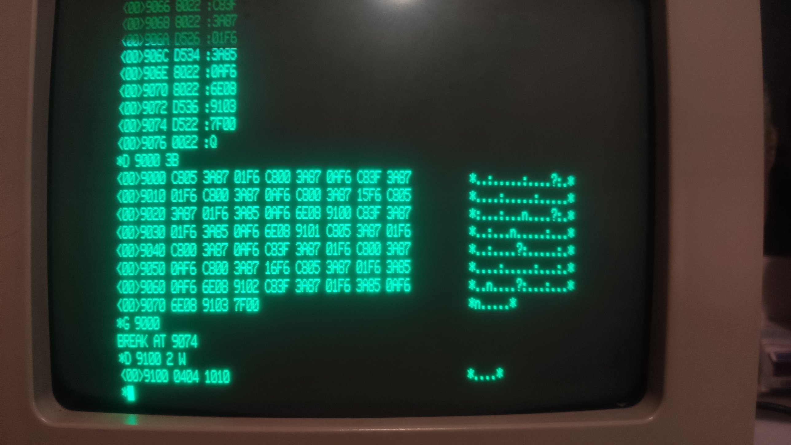

# Test 02: Z8010 commands %15 and %16 ignore the data byte

Status: **done on the real machine** (2026-10-16), result equals the emulator.

## What is tested

Commands %15 and %16 set the CPU-inhibit (bit 04) and DMA-inhibit (bit 10) attribute flag of
**all** 64 descriptors. The data byte that goes with the special I/O write is not part of
the command. The old emulation cleared the flags when the data byte was 0. The program sets
the attribute byte of descriptors 5 and 63 to 00, issues %15 with data byte 00, reads both
attribute bytes back, repeats this for %16.

The program only touches the **stack MMU** (special I/O port low byte `F6`, command number
in the high byte). It runs in system mode, non segmented, from RAM; the MMU is not enabled.
**Reset the machine afterwards** (descriptors of the stack MMU are changed).

## Procedure

Start: reset, Return at the 8 bit monitor, `X`, any key at "Press NMI", then NMI (nothing
else before the NMI, any input stops the boot). At the `*` prompt of MON16: `D <address>`,
then every word on its own line, then `Q`. `G <address>` starts the program, the monitor
answers `BREAK AT ...`. `D <address> <count> W` shows memory (count in words). Hex digits in
upper case only.

Words for `D 9000` (59 words; generator `tools/gen_z8010.py`):

```
C805 3A87 01F6 C800 3A87 0AF6 C83F 3A87
01F6 C800 3A87 0AF6 C800 3A87 15F6 C805
3A87 01F6 3A85 0AF6 6E08 9100 C83F 3A87
01F6 3A85 0AF6 6E08 9101 C805 3A87 01F6
C800 3A87 0AF6 C83F 3A87 01F6 C800 3A87
0AF6 C800 3A87 16F6 C805 3A87 01F6 3A85
0AF6 6E08 9102 C83F 3A87 01F6 3A85 0AF6
6E08 9103 7F00
```

Then `Q`, `G 9000`, `D 9100 2 W`.

Opcodes (checked against `z8000tbl.hxx`): `C8vv` = `ldb rl0,#vv`, `3A87 pppp` =
`soutb pppp,rl0` (special I/O), `3A85 pppp` = `sinb rl0,pppp`, `6E08 aaaa` = `ldb %aaaa,rl0`,
`6008 aaaa` = `ldb rl0,%aaaa`, `7F00` = `sc #0` (back to the monitor).

## Assembler listing

Address, machine words, instruction, comment (hand assembled; the words are what you type).

```
; clear the attribute byte of descriptors 5 and 63
9000  C805                 ldb  rl0,#%05             ; SAR := 5
9002  3A87 01F6            soutb %01F6,rl0           ; stack MMU, cmd %01: SAR (segment address register)
9006  C800                 ldb  rl0,#%00             ; attribute := 00
9008  3A87 0AF6            soutb %0AF6,rl0           ; stack MMU, cmd %0A: attribute byte of the selected descriptor
900C  C83F                 ldb  rl0,#%3F             ; SAR := 63
900E  3A87 01F6            soutb %01F6,rl0           ; stack MMU, cmd %01: SAR (segment address register)
9012  C800                 ldb  rl0,#%00             ; attribute := 00
9014  3A87 0AF6            soutb %0AF6,rl0           ; stack MMU, cmd %0A: attribute byte of the selected descriptor
; command %15 with data byte 00
9018  C800                 ldb  rl0,#%00             ; data byte 00 (must not matter)
901A  3A87 15F6            soutb %15F6,rl0           ; stack MMU, cmd %15: set CPU-inhibit in all descriptors
901E  C805                 ldb  rl0,#%05             ; SAR := 5
9020  3A87 01F6            soutb %01F6,rl0           ; stack MMU, cmd %01: SAR (segment address register)
9024  3A85 0AF6            sinb  rl0,%0AF6           ; cmd %0A: attribute byte of the selected descriptor
9028  6E08 9100            ldb  %9100,rl0            ; result byte 0: attribute of descriptor 5 after %15
902C  C83F                 ldb  rl0,#%3F             ; SAR := 63
902E  3A87 01F6            soutb %01F6,rl0           ; stack MMU, cmd %01: SAR (segment address register)
9032  3A85 0AF6            sinb  rl0,%0AF6           ; cmd %0A: attribute byte of the selected descriptor
9036  6E08 9101            ldb  %9101,rl0            ; result byte 1: attribute of descriptor 63 after %15
903A  C805                 ldb  rl0,#%05             ; SAR := 5
903C  3A87 01F6            soutb %01F6,rl0           ; stack MMU, cmd %01: SAR (segment address register)
9040  C800                 ldb  rl0,#%00             ; attribute := 00
9042  3A87 0AF6            soutb %0AF6,rl0           ; stack MMU, cmd %0A: attribute byte of the selected descriptor
9046  C83F                 ldb  rl0,#%3F             ; SAR := 63
9048  3A87 01F6            soutb %01F6,rl0           ; stack MMU, cmd %01: SAR (segment address register)
904C  C800                 ldb  rl0,#%00             ; attribute := 00
904E  3A87 0AF6            soutb %0AF6,rl0           ; stack MMU, cmd %0A: attribute byte of the selected descriptor
; command %16 with data byte 00
9052  C800                 ldb  rl0,#%00             ; data byte 00 (must not matter)
9054  3A87 16F6            soutb %16F6,rl0           ; stack MMU, cmd %16: set DMA-inhibit in all descriptors
9058  C805                 ldb  rl0,#%05             ; SAR := 5
905A  3A87 01F6            soutb %01F6,rl0           ; stack MMU, cmd %01: SAR (segment address register)
905E  3A85 0AF6            sinb  rl0,%0AF6           ; cmd %0A: attribute byte of the selected descriptor
9062  6E08 9102            ldb  %9102,rl0            ; result byte 2: attribute of descriptor 5 after %16
9066  C83F                 ldb  rl0,#%3F             ; SAR := 63
9068  3A87 01F6            soutb %01F6,rl0           ; stack MMU, cmd %01: SAR (segment address register)
906C  3A85 0AF6            sinb  rl0,%0AF6           ; cmd %0A: attribute byte of the selected descriptor
9070  6E08 9103            ldb  %9103,rl0            ; result byte 3: attribute of descriptor 63 after %16
9074  7F00                 sc   #0                   ; BREAK: back to the monitor
```

## What comes out

Four bytes at `%9100`, in the order: descriptor 5 after %15, descriptor 63 after %15,
descriptor 5 after %16, descriptor 63 after %16.

Expected (and emulator, `D 9100 2 W`): `0404 1010`, that is `04 04 10 10`.
**Real machine: `0404 1010`.**
`00` instead of `04` / `10` would mean that the data byte 00 decides the flags.

## What it means and which claim it supports

The real chip shows `04 04 10 10`: the flags are set although the data byte was 00, so the
data byte does not take part in the command (an implementation that lets the data byte decide
would show `00 00 00 00`). That is the claim of commit `03dffddf`
("%15/%16 always set the flags"); documents behind it: U8010 description 6.2.21/6.2.22
("no data has to be passed to the MMU", content of the source register ignored), ZiLOG
System 8000 Hardware Reference Manual table 3-2, Moore table 5-3. WEGA's `_invsdrs` writes
%15 with whatever is left in a register (seen: 00, 3E, D8).

## Photos of the screen (real machine)



*Program entered, G 9000, result 0404 1010.*

## Result on the real machine

| Date | Board / monitor | Bytes read | Same as the emulator? |
|---|---|---|---|
| 2026-10-16 | 16 bit board, MON16 | `04 04 10 10` (`D 9100 2 W`: `0404 1010`) | yes |
