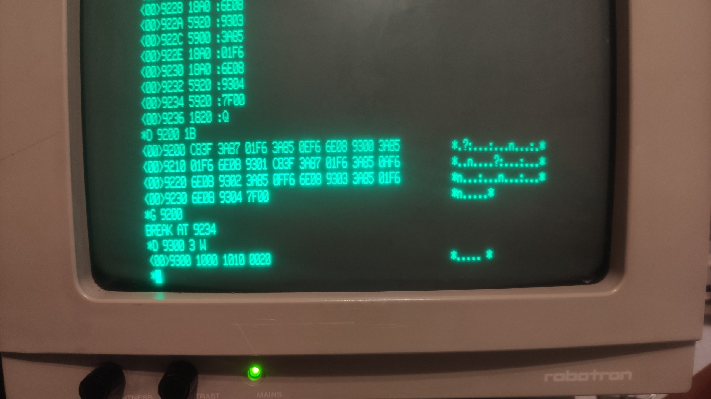

# Test 03: Z8010 segment address register wraps from 63 to 0

Status: **done on the real machine** (2026-10-16), result equals the emulator.

## What is tested

The descriptor autoincrement commands (0E: read attribute then SAR+1, 0F: read field,
then DSC+1 and SAR+1 after the attribute byte) behind descriptor 63 continue with
descriptor 0 (U8010 description 6.2.13, 6.2.14, 6.2.16; Moore p. 355/358). The old emulation
stayed at 63. The program sets SAR to 63, reads with command 0E, reads SAR back; sets SAR to 63
again, reads with 0A and 0F, reads SAR back.

The program only touches the **stack MMU** (special I/O port low byte `F6`, command number
in the high byte). It runs in system mode, non segmented, from RAM; the MMU is not enabled.
**Reset the machine afterwards** (descriptors of the stack MMU are changed).

## Procedure

Start: reset, Return at the 8 bit monitor, `X`, any key at "Press NMI", then NMI (nothing
else before the NMI, any input stops the boot). At the `*` prompt of MON16: `D <address>`,
then every word on its own line, then `Q`. `G <address>` starts the program, the monitor
answers `BREAK AT ...`. `D <address> <count> W` shows memory (count in words). Hex digits in
upper case only.

Words for `D 9200` (27 words; generator `tools/gen_z8010.py`):

```
C83F 3A87 01F6 3A85 0EF6 6E08 9300 3A85
01F6 6E08 9301 C83F 3A87 01F6 3A85 0AF6
6E08 9302 3A85 0FF6 6E08 9303 3A85 01F6
6E08 9304 7F00
```

Then `Q`, `G 9200`, `D 9300 3 W`.

Opcodes (checked against `z8000tbl.hxx`): `C8vv` = `ldb rl0,#vv`, `3A87 pppp` =
`soutb pppp,rl0` (special I/O), `3A85 pppp` = `sinb rl0,pppp`, `6E08 aaaa` = `ldb %aaaa,rl0`,
`6008 aaaa` = `ldb rl0,%aaaa`, `7F00` = `sc #0` (back to the monitor).

## Assembler listing

Address, machine words, instruction, comment (hand assembled; the words are what you type).

```
9200  C83F                 ldb  rl0,#%3F             ; SAR := 63
9202  3A87 01F6            soutb %01F6,rl0           ; stack MMU, cmd %01: SAR (segment address register)
9206  3A85 0EF6            sinb  rl0,%0EF6           ; cmd %0E: attribute byte, then SAR := SAR+1
920A  6E08 9300            ldb  %9300,rl0            ; result byte 0: attribute of 63 (SAR is incremented afterwards)
920E  3A85 01F6            sinb  rl0,%01F6           ; cmd %01: SAR (segment address register)
9212  6E08 9301            ldb  %9301,rl0            ; result byte 1: SAR after 0E (00 = wrapped)
9216  C83F                 ldb  rl0,#%3F             ; SAR := 63
9218  3A87 01F6            soutb %01F6,rl0           ; stack MMU, cmd %01: SAR (segment address register)
921C  3A85 0AF6            sinb  rl0,%0AF6           ; cmd %0A: attribute byte of the selected descriptor
9220  6E08 9302            ldb  %9302,rl0            ; result byte 2: attribute of 63, select attribute byte
9224  3A85 0FF6            sinb  rl0,%0FF6           ; cmd %0F: descriptor field, DSC+1 (SAR+1 after the attribute byte)
9228  6E08 9303            ldb  %9303,rl0            ; result byte 3: read again, DSC passes the attribute: SAR+1
922C  3A85 01F6            sinb  rl0,%01F6           ; cmd %01: SAR (segment address register)
9230  6E08 9304            ldb  %9304,rl0            ; result byte 4: SAR after 0F (00 = wrapped)
9234  7F00                 sc   #0                   ; BREAK: back to the monitor
```

## What comes out

Five bytes at `%9300`: attribute (cmd 0E), **SAR after 0E**, attribute (cmd 0A),
attribute (cmd 0F), **SAR after 0F**. `D 9300 3 W`.

Expected: the 2nd and 5th byte are `00` (emulator: `10 00 10 10 00`, the attribute bytes
are leftovers of test 02: `10`; if test 02 was not run before they differ).
Emulator before the fix: `3F` (stays at 63).

**Real machine: `1000 1010 0020`**, i.e. bytes `10 00 10 10 00` and then `20`. The last byte is
not a result (the dump shows 6 bytes, the program writes 5), it is leftover memory. SAR after
0E = `00`, SAR after 0F = `00`, the attribute bytes are `10` (left from test 02, as expected).

## What it means and which claim it supports

On the real chip both SAR values are `00`: after descriptor 63 the register continues with
descriptor 0 (a 6 bit counter without carry out), neither staying at `3F` nor showing a 7th
bit (`40`), for both the attribute read (cmd 0E) and the read that passes the attribute byte
(cmd 0F).
That supports the claim in commit `03dffddf` ("SAR autoincrement wraps from 63 to 0").
Nothing else in the P8000 software depends on it (the kernel always writes SAR first), so a
different real value would be a finding to document, not a boot problem.

## Photos of the screen (real machine)



*Program entered, G 9200, result 1000 1010 0020.*

## Result on the real machine

| Date | Board / monitor | Bytes read | Same as the emulator? |
|---|---|---|---|
| 2026-10-16 | 16 bit board, MON16 | `10 00 10 10 00` (`D 9300 3 W`: `1000 1010 0020`, the final `20` is not a result) | yes |
