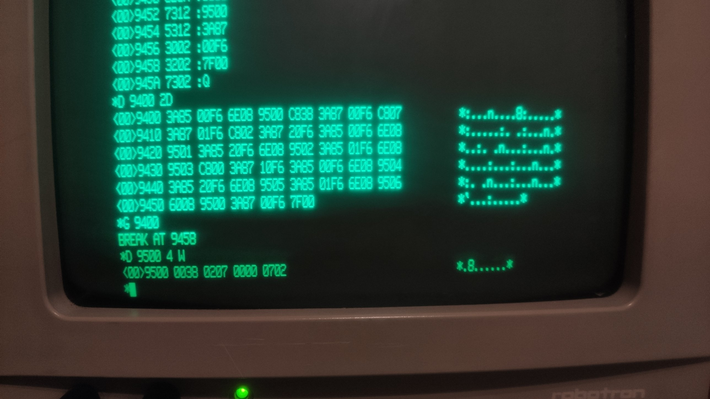

# Test 04: Z8010 command %10 resets MR, VTR and DSCR

Status: **done on the real machine** (2026-10-16), result equals the emulator.

## What is tested

Command %10 clears the mode register, the violation type register and the descriptor
selector register; SAR and the descriptors stay (U8010 description 6.2.17, table 6.2). The old
emulation did not know the command. The program reads MR, writes MR = 38 (master enable and
translate stay off), SAR = 7, DSCR = 2, reads all three back, issues %10, reads them again,
then writes the saved MR back.

The program only touches the **stack MMU** (special I/O port low byte `F6`, command number
in the high byte). It runs in system mode, non segmented, from RAM; the MMU is not enabled.
**Reset the machine afterwards** (descriptors of the stack MMU are changed).

## Procedure

Start: reset, Return at the 8 bit monitor, `X`, any key at "Press NMI", then NMI (nothing
else before the NMI, any input stops the boot). At the `*` prompt of MON16: `D <address>`,
then every word on its own line, then `Q`. `G <address>` starts the program, the monitor
answers `BREAK AT ...`. `D <address> <count> W` shows memory (count in words). Hex digits in
upper case only.

Words for `D 9400` (45 words; generator `tools/gen_z8010.py`):

```
3A85 00F6 6E08 9500 C838 3A87 00F6 C807
3A87 01F6 C802 3A87 20F6 3A85 00F6 6E08
9501 3A85 20F6 6E08 9502 3A85 01F6 6E08
9503 C800 3A87 10F6 3A85 00F6 6E08 9504
3A85 20F6 6E08 9505 3A85 01F6 6E08 9506
6008 9500 3A87 00F6 7F00
```

Then `Q`, `G 9400`, `D 9500 4 W`.

Opcodes (checked against `z8000tbl.hxx`): `C8vv` = `ldb rl0,#vv`, `3A87 pppp` =
`soutb pppp,rl0` (special I/O), `3A85 pppp` = `sinb rl0,pppp`, `6E08 aaaa` = `ldb %aaaa,rl0`,
`6008 aaaa` = `ldb rl0,%aaaa`, `7F00` = `sc #0` (back to the monitor).

## Assembler listing

Address, machine words, instruction, comment (hand assembled; the words are what you type).

```
9400  3A85 00F6            sinb  rl0,%00F6           ; cmd %00: MR (mode register)
9404  6E08 9500            ldb  %9500,rl0            ; result byte 0: MR at start (saved for the end)
9408  C838                 ldb  rl0,#%38             ; MR := 38 (master enable and translate stay off)
940A  3A87 00F6            soutb %00F6,rl0           ; stack MMU, cmd %00: MR (mode register)
940E  C807                 ldb  rl0,#%07             ; SAR := 7
9410  3A87 01F6            soutb %01F6,rl0           ; stack MMU, cmd %01: SAR (segment address register)
9414  C802                 ldb  rl0,#%02             ; DSCR := 2
9416  3A87 20F6            soutb %20F6,rl0           ; stack MMU, cmd %20: DSCR (descriptor selector)
941A  3A85 00F6            sinb  rl0,%00F6           ; cmd %00: MR (mode register)
941E  6E08 9501            ldb  %9501,rl0            ; result byte 1: MR set
9422  3A85 20F6            sinb  rl0,%20F6           ; cmd %20: DSCR (descriptor selector)
9426  6E08 9502            ldb  %9502,rl0            ; result byte 2: DSC set
942A  3A85 01F6            sinb  rl0,%01F6           ; cmd %01: SAR (segment address register)
942E  6E08 9503            ldb  %9503,rl0            ; result byte 3: SAR set
9432  C800                 ldb  rl0,#%00             ; command %10
9434  3A87 10F6            soutb %10F6,rl0           ; stack MMU, cmd %10: reset MR, VTR and DSCR
9438  3A85 00F6            sinb  rl0,%00F6           ; cmd %00: MR (mode register)
943C  6E08 9504            ldb  %9504,rl0            ; result byte 4: MR after %10
9440  3A85 20F6            sinb  rl0,%20F6           ; cmd %20: DSCR (descriptor selector)
9444  6E08 9505            ldb  %9505,rl0            ; result byte 5: DSC after %10
9448  3A85 01F6            sinb  rl0,%01F6           ; cmd %01: SAR (segment address register)
944C  6E08 9506            ldb  %9506,rl0            ; result byte 6: SAR after %10
9450  6008 9500            ldb  rl0,%9500            ; restore the MR saved at start
9454  3A87 00F6            soutb %00F6,rl0           ; MR := saved value
9458  7F00                 sc   #0                   ; BREAK: back to the monitor
```

## What comes out

Seven bytes at `%9500`, `D 9500 4 W`: MR at start, MR set, DSC set, SAR set, **MR after
%10**, **DSC after %10**, **SAR after %10**.

Expected (emulator): `00 38 02 07 00 00 07`. The first byte is whatever MR holds at start
(the real MON16 may leave a different value).

**Real machine: `0038 0207 0000 0702`**, i.e. bytes `00 38 02 07 00 00 07` and then `02`. The last
byte is not a result (the dump shows 8 bytes, the program writes 7), it is leftover memory. MR
at start was `00`.

## What it means and which claim it supports

On the real chip MR and DSC are `00` after %10 and SAR is still `07`. That means %10 resets exactly MR, VTR and DSCR (VTR
is not tested, it cannot be set without a violation) and not the SAR. That supports the claim
in commit `03dffddf` ("command %10 resets MR, VTR and DSCR").

## Photos of the screen (real machine)



*Program entered, G 9400, result 0038 0207 0000 0702.*

## Result on the real machine

| Date | Board / monitor | Bytes read | Same as the emulator? |
|---|---|---|---|
| 2026-10-16 | 16 bit board, MON16 | `00 38 02 07 00 00 07` (`D 9500 4 W`: `0038 0207 0000 0702`, the final `02` is not a result) | yes |
