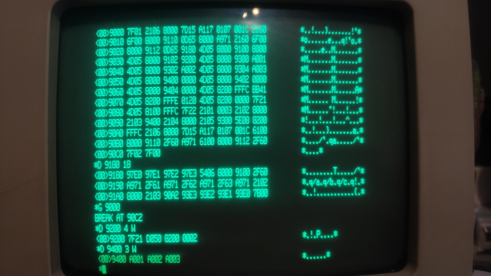

# Test 06: a repeating block instruction at the end of a segment restarts in the same segment

Status: **done on the real machine** (2026-10-16, 4 MiB RAM installed), result equals the emulator with the change (old core and new core, emulator run 2026-10-16, are below).

## What is tested

Commit `915b2c70` (cpu/z8000, to be squashed into `d613b434`): the repeating block instructions
(`ldir`, `cpir`, `inir`, ...) start themselves again by going back four bytes. After the change
of test 05 (the PC offset wraps at `FFFF`), a two word instruction in the last two words of a
segment (`<<2>>%FFFC`) leaves the PC at `<<2>>%0000` after the fetch, and "back four bytes" must
go to `<<2>>%FFFC` again, not to the previous segment. On a real Z8001 the repeat simply runs
the same instruction again; the segment number is never changed by the program counter
(U8000 CPU description 3.4.2, Moore p. 19, see test 05).

The program writes `ldir @rr2,@rr4,r1` (`BB41 0120`) to `<<2>>%FFFC`, copies 3 words from
`%9300` to `%9400`, and puts

- `sc #%21` at `<<2>>%0000`: executed after the last round if the repeat stays in segment 2,
- `sc #%22` at `<<1>>%FFFC`: executed if the repeat falls back into segment 1 (the old behaviour of the emulator).

The system call handler stores the frame (identifier, FCW, saved PC) at `%9200` like in test 05
and returns to the end of the main program. Afterwards `%9400` holds the copied words.

Assumption to check: with the MMUs off, segment `n` is the physical memory at `n * 64 KiB`
and main memory exists at `%10000` to `%2FFFF` (as in test 05).

## Procedure

Start: reset, Return at the 8 bit monitor, `X`, any key at "Press NMI", then NMI (nothing
else before the NMI, any input stops the boot). At the `*` prompt of MON16: `D <address>`,
then every word on its own line, then `Q`. `G <address>` starts the program, the monitor
answers `BREAK AT ...`. `D <address> <count> W` shows memory (count in words). Hex digits in
upper case only.

Words for `D 9000` (98 words):

```
7F01 2106 8000 7D15 A117 0107 001C 2160
6F00 8000 9110 0D65 8000 A971 2160 6F00
8000 9112 0D65 9180 4D05 8000 9100 8000
4D05 8000 9102 9200 4D05 8000 9300 A001
4D05 8000 9302 A002 4D05 8000 9304 A003
4D05 8000 9400 0000 4D05 8000 9402 0000
4D05 8000 9404 0000 4D05 8200 FFFC BB41
4D05 8200 FFFE 0120 4D05 8200 0000 7F21
4D05 8100 FFFC 7F22 2101 0003 2102 8000
2103 9400 2104 8000 2105 9300 5E08 8200
FFFC 2106 8000 7D15 A117 0107 001C 6100
8000 9110 2F60 A971 6100 8000 9112 2F60
7F02 7F00
```

`Q`, then the words for `D 9180` (24 words, the handler):

```
97E0 97E1 97E2 97E3 5406 8000 9100 2F60
A971 2F61 A971 2F62 A971 2F63 A971 2102
8000 2103 90A2 93E3 93E2 93E1 93E0 7B00
```

`Q`, `G 9000`, `D 9200 4 W`, `D 9400 3 W`.

## Assembler listing

Address, machine words, instruction, comment (hand assembled; the words are what you type).

```
; main program, runs in segmented mode; installs the system call handler like test 05
9000  7F01                 sc   #1                   ; MON16: switch to segmented mode
9002  2106 8000            ld   r6,#%8000            ; segment word of rr6: segment 0 in long form
9006  7D15                 ldctl r1,PSAPOFF          ; offset of the program status area (PSAP)
9008  A117                 ld   r7,r1                
900A  0107 001C            add  r7,#%1C              ; rr6 -> PC segment word of the system call entry
900E  2160                 ld   r0,@rr6              
9010  6F00 8000 9110       ld   %9110,r0             ; keep the old PC segment word
9016  0D65 8000            ld   @rr6,#%8000          ; new vector: segment 0 ...
901A  A971                 inc  r7,#2                
901C  2160                 ld   r0,@rr6              
901E  6F00 8000 9112       ld   %9112,r0             ; keep the old PC offset
9024  0D65 9180            ld   @rr6,#%9180          ; ... offset %9180 = the handler
9028  4D05 8000 9100 8000  ld   %9100,#%8000         ; frame buffer pointer, segment word
9030  4D05 8000 9102 9200  ld   %9102,#%9200         ; frame buffer pointer, offset: the frame goes to %9200
; source words at %9300, destination words at %9400 (segment 0)
9038  4D05 8000 9300 A001  ld   %9300,#%A001         ; source word 0
9040  4D05 8000 9302 A002  ld   %9302,#%A002         ; source word 1
9048  4D05 8000 9304 A003  ld   %9304,#%A003         ; source word 2
9050  4D05 8000 9400 0000  ld   %9400,#%0000         ; destination word 0, cleared
9058  4D05 8000 9402 0000  ld   %9402,#%0000         ; destination word 1, cleared
9060  4D05 8000 9404 0000  ld   %9404,#%0000         ; destination word 2, cleared
; code in segment 2 (physical %20000) and a marker in segment 1 (physical %10000), main memory
9068  4D05 8200 FFFC BB41  ld   <<2>>%FFFC,#%BB41    ; segment 2, last two words: ldir @rr2,@rr4,r1 (a two word instruction)
9070  4D05 8200 FFFE 0120  ld   <<2>>%FFFE,#%0120    ; second word of the ldir
9078  4D05 8200 0000 7F21  ld   <<2>>%0000,#%7F21    ; segment 2, offset 0: sc #%21  (reached after the ldir if the repeat stays in segment 2)
9080  4D05 8100 FFFC 7F22  ld   <<1>>%FFFC,#%7F22    ; segment 1, offset FFFC: sc #%22  (reached if the repeat borrows from the segment)
9088  2101 0003            ld   r1,#3                ; word count
908C  2102 8000            ld   r2,#%8000            ; destination rr2 = segment 0 ...
9090  2103 9400            ld   r3,#%9400            ; ... offset %9400
9094  2104 8000            ld   r4,#%8000            ; source rr4 = segment 0 ...
9098  2105 9300            ld   r5,#%9300            ; ... offset %9300
909C  5E08 8200 FFFC       jp   <<2>>%FFFC           ; run the ldir at the end of segment 2
; the handler continues here (it changes the saved PC to this address)
90A2  2106 8000            ld   r6,#%8000            ; restore the vector
90A6  7D15                 ldctl r1,PSAPOFF          
90A8  A117                 ld   r7,r1                
90AA  0107 001C            add  r7,#%1C              
90AE  6100 8000 9110       ld   r0,%9110             
90B4  2F60                 ld   @rr6,r0              ; old PC segment word back
90B6  A971                 inc  r7,#2                
90B8  6100 8000 9112       ld   r0,%9112             
90BE  2F60                 ld   @rr6,r0              ; old PC offset back
90C0  7F02                 sc   #2                   ; MON16: back to non segmented mode
90C2  7F00                 sc   #0                   ; BREAK: back to the monitor

; handler for the system call vector, runs on the system stack (rr14)
9180  97E0                 pop  r0,@rr14             ; identifier word: 7F21 or 7F22 tells which sc was executed
9182  97E1                 pop  r1,@rr14             ; saved FCW
9184  97E2                 pop  r2,@rr14             ; saved PC segment word: shows the segment the sc was fetched from
9186  97E3                 pop  r3,@rr14             ; saved PC offset (0002)
9188  5406 8000 9100       ldl  rr6,%9100            ; rr6 := frame buffer pointer
918E  2F60                 ld   @rr6,r0              ; store identifier
9190  A971                 inc  r7,#2                
9192  2F61                 ld   @rr6,r1              ; store FCW
9194  A971                 inc  r7,#2                
9196  2F62                 ld   @rr6,r2              ; store PC segment word
9198  A971                 inc  r7,#2                
919A  2F63                 ld   @rr6,r3              ; store PC offset
919C  A971                 inc  r7,#2                
919E  2102 8000            ld   r2,#%8000            ; new return segment: 0 (long form)
91A2  2103 90A2            ld   r3,#%90A2            ; new return offset: the continue address of the main program
91A6  93E3                 push @rr14,r3             ; rebuild the frame (reverse order)
91A8  93E2                 push @rr14,r2             
91AA  93E1                 push @rr14,r1             
91AC  93E0                 push @rr14,r0             
91AE  7B00                 iret                      ; return to the continue address
```

## What comes out

One frame (identifier, FCW, PC segment word, PC offset) at `%9200` and three words at `%9400`.

| | Frame at `%9200` | Words at `%9400` | Meaning |
|---|---|---|---|
| Emulator with the change (expected on the real machine too) | `7F21 D050 8200 0002` | `A001 A002 A003` | all three rounds ran in segment 2, then `sc #%21` at `<<2>>%0000` |
| Emulator without the change (old core) | `7F22 D000 8100 FFFE` | `A001 0000 0000` | after the first round the repeat went back into segment 1, where `sc #%22` was executed |

The monitor shows `BREAK AT 90C2` afterwards.

The FCW differs between the two rows because of the flags: after a finished `ldir` the emulator
has Z and V set (`D050`), in the old run the `sc` was reached after the first round (`D000`).
The flags are not part of the claim. The real machine shows the same FCW `D050`, so Z and V are set after a finished `ldir`
there too.

## What it means and which claim it supports

`7F21 ... 8200 0002` (FCW may differ in the flag bits) and `A001 A002 A003` mean the real CPU repeats the block instruction in the
segment where it stands, even if the instruction ends exactly at the segment end. That is what
the change `915b2c70` relies on (the program counter offset wraps and never changes the segment).
`7F22 ... 8100 FFFE` would mean that the real CPU goes back into the previous segment and the
change would be wrong. 

## Photos of the screen (real machine)



*Both programs entered, G 9000, frame 7F21 D050 8200 0002, words A001 A002 A003.*

## Result on the real machine

| Date | Board / monitor | Bytes read | Same as the emulator? |
|---|---|---|---|
| 2026-10-16 | 16 bit board, 4 MiB RAM, MON16 | `7F21 D050 8200 0002` (`D 9200 4 W`), `A001 A002 A003` (`D 9400 3 W`) | yes, also the FCW `D050` (Z and V set after the finished `ldir`); the old core gives `7F22 D000 8100 FFFE` and `A001 0000 0000` |
